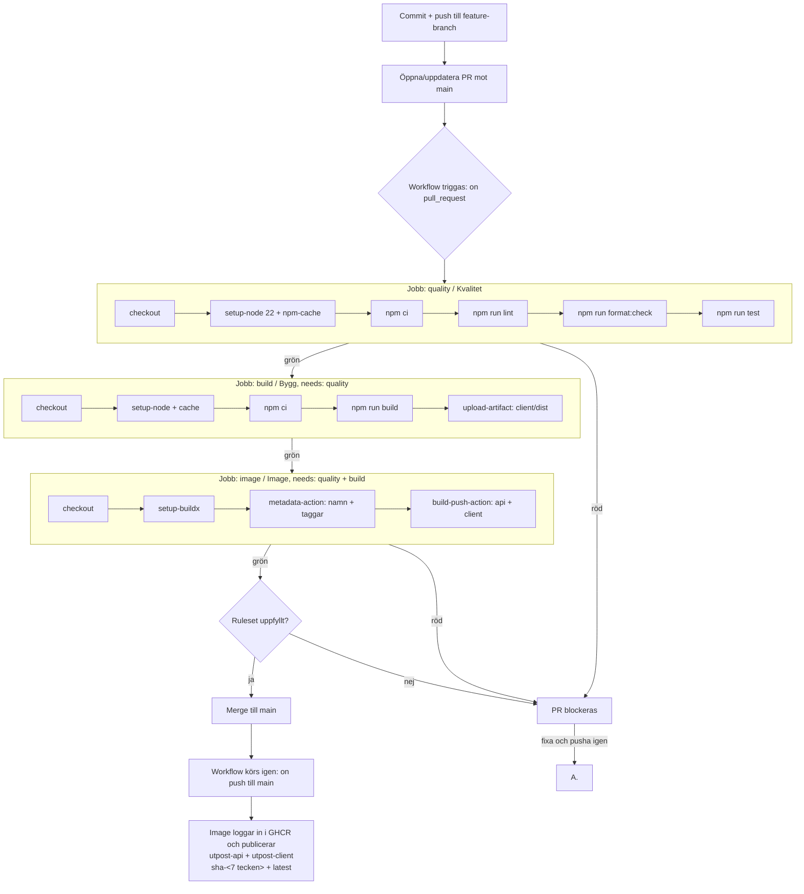

# CI-pipeline

## Flöde: från commit till merge

## Jobbet `Image`

Jobbet bygger Docker-imagerna för `api` och `client` i pipelinen. Vi bygger och pushar **aldrig** imagerna från egen dator: en Mac med M-chip bygger arm64, servern kör amd64.

- **`needs: [quality, build]`:** ingen image byggs av kod som inte klarat kontrollerna.
- **På PR:** imagerna byggs (så att en trasig Dockerfile stoppar PR:en) men publiceras **inte**. Ingen inloggning sker.
- **På `main`:** jobbet loggar in i GHCR med `GITHUB_TOKEN` och publicerar `ghcr.io/<ägare>/<repo>-api` och `ghcr.io/<ägare>/<repo>-client`.
- **Namn och taggar** räknas ut av `docker/metadata-action`: `sha-<7 tecken>` (commiten imagen byggdes av) och `latest` på `main`. Den gör också namnet till gemener, vilket GHCR kräver.
- **Rättigheter:** `permissions: packages: write` finns **bara** på det här jobbet. Resten av workflowet har `contents: read`.
- **Cache:** lagren cachas i GitHub Actions (`type=gha`), separat för `api` och `client`.
- **Paketen** i GHCR är publika, så servern kan hämta dem utan inloggning.

## Vad varje steg fångar

| Steg         | Fångar                                                                         |
| ------------ | ------------------------------------------------------------------------------ |
| npm ci       | Lockfil och package.json som inte stämmer överens; garanterar exakta versioner |
| lint         | Kodproblem och misstänkta mönster (ESLint)                                     |
| format:check | Filer som inte följer Prettier. Kontrollerar bara, ändrar aldrig               |
| test         | Regressioner i beteende (Vitest)                                               |
| build        | Trasiga importer och byggfel som lint och test kan missa                       |
| Image        | Dockerfiler som inte bygger; på main publiceras imagerna i GHCR                |
| Ruleset      | Att inget mergas utan PR, review och gröna checks                              |

## Uppmätta tider (en körning)

Körning: [2026-09-28] · Sekventiell (needs: quality): ja

| Steg                                 | Kvalitet | Bygg |
| ------------------------------------ | -------- | ---- |
| Set up job                           | 0s       | 1s   |
| checkout                             | 1s       | 1s   |
| setup-node                           | 1s       | 1s   |
| npm ci                               | 5s       | 5s   |
| lint                                 | 2s       | –    |
| format:check                         | 0s       | –    |
| test                                 | 2s       | –    |
| build                                | –        | 1s   |
| upload-artifact                      | –        | 1s   |
| Post-steg + Complete job (differens) | 2s       | 2s   |
| **Jobbtid enligt GitHub**            | 13s      | 12s  |

**Total pipeline-tid (vägg-tid):** 30s (jobben summerar till 25s, resten är
uppstart av runners och väntan mellan jobben)

## Ruleset på `main`

Bekräfta uppgifterna med den som ställt in rulesetet:

- Restrict deletions
- Pull request krävs innan merge, minst en godkännare
- Required status checks: `Kvalitet`, `Bygg` och `Image`
- Branchen som mergas behöver vara up to date med main
- Blockera force push
